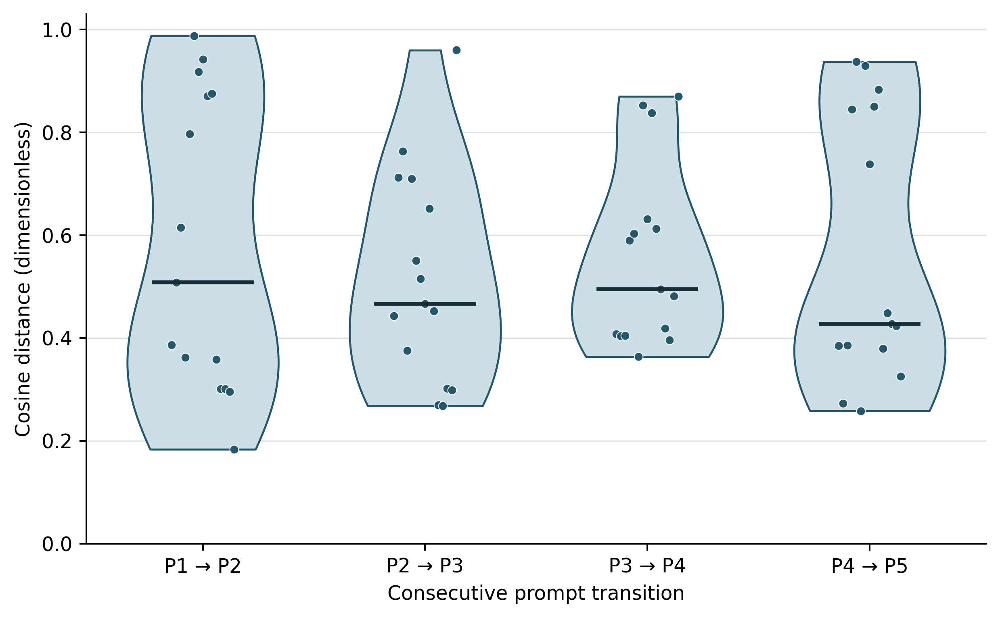

# Media narratives of violence in Mexico: computational supplements

Numerical data and executable analysis supporting **Human-Computer Interaction for Recursive Prompt and Image Generation on Media Narratives of Violence in Mexico**, Frontiers in Computer Science, article 1877314.

Associated article DOI: [10.3389/fcomp.2026.1877314](https://doi.org/10.3389/fcomp.2026.1877314).

This repository reproduces descriptive summaries and paired Wilcoxon tests from numerical arrays exported by the research team. It contains 60 direct prompt-transition distances, 75 participant-to-centroid distances, five 384-dimensional stage centroids, aggregate term weights, and monthly descriptive counts for the 105-news-item corpus.



## Run the analysis

Requires Python 3.12. The analysis runs offline after installing dependencies.

```bash
python -m venv .venv
# Linux/macOS
source .venv/bin/activate
# Windows PowerShell: .venv\Scripts\Activate.ps1
python -m pip install -r requirements.txt
python scripts/reproduce.py --verify
```

The command creates the descriptive summaries, recomputed Wilcoxon/Holm results, Figure 13 in PDF/EPS/PNG, and a verification report in `results/`. To use a different output directory:

```bash
python scripts/reproduce.py --verify --output-dir /path/to/results
```

## Included materials

| Location | Contents |
| --- | --- |
| `data/derived/` | Numeric and aggregate exports with participant labels P01–P15 |
| `data/reference/` | Source-workbook statistics and the printed proof values used for verification |
| `data/provenance.json` | Source filenames, hashes, transformations and release scope |
| `scripts/reproduce.py` | Offline analysis and verification |
| `results/` | Generated tables, figure and verification results |
| `docs/reproducibility.md` | Statistical definitions, precision choices and limits |
| `docs/proof_corrections.md` | Exact numerical corrections identified from the source export |
| `CITATION.cff` | Citation metadata for this computational supplement |

## Scope of reproducibility

The original numerical exports are sufficient to reproduce the reported paired centroid-distance Wilcoxon statistics. This release does **not** rerun the historical text-cleaning, embedding, original image-generation or news-collection pipelines. Their original executable pipeline and complete raw inputs have not been supplied to this repository.

No participant submission documents, participant names, free-text responses, identity crosswalks, or private Drive links are included. P01–P15 refer only to workbook row order. The complete 105-article source/URL list, full anonymized questionnaire responses and dissemination video are not included in this release. They should not be described as present in this repository until added and checked.

## Statistical interpretation

Direct consecutive-prompt distances and stage-specific participant-to-centroid distances are separate data products. The Wilcoxon tests use the latter, paired within participants, with a two-sided alternative and `zero_method="wilcox"`. Holm adjustment is applied to the four **unrounded** p-values.

The exported column named `median_delta` is the **median of participant-level paired differences**, not the difference between the two stage medians. The source values reproduce under this definition. See the [statistical notes](docs/reproducibility.md).

The tests remain exploratory: stage-specific centroids are estimated from the same participants, creating shared-reference dependence. The data do not establish causal learning effects or population-level changes.

## Citation and DOI

Use `CITATION.cff` to cite this supplement and cite the associated article separately. This repository has **not** yet been assigned its own DOI. A repository DOI must not be confused with the article DOI above.

A versioned release can be archived in Zenodo to obtain a persistent DOI. That archive preserves the exact release used for the paper, while later code changes can continue on GitHub. See [release instructions](docs/release.md).

## Authors

Roman Anselmo Mora-Gutiérrez; Yadira Alatriste-Martinez; Oscar Antonio Manzanarez-Betancourt; Luis Angel Meza-Zarate; Edwin Montes-Orozco; Gilberto Sinuhe Torres Cockrell.

## Licenses

Code: MIT, under `LICENSE`. Numerical and aggregate data: CC BY 4.0, under `data/LICENSE.md`. These licenses do not cover the article, third-party news content or participant documents, which are not distributed here.
